

# GapZer0

**NIST CSF 2.0을 기반으로 국내 정보보호 컴플라이언스 프레임워크 만들기** 
화이트햇스쿨 4기 · 2차 팀 프로젝트

---

## 프로젝트 소개

GapZer0는 두 기준을 하나의 통제체계로 통합하는 프로젝트입니다. 하나는 국내 정보보호 및 개인정보보호 관리체계 인증기준인 **ISMS-P**이고, 다른 하나는 결과(Outcome) 중심의 사이버보안 프레임워크인 **NIST CSF 2.0**입니다.

두 기준의 요구사항을 세부 항목 단위로 매핑해 공통 요구사항과 서로 대응하지 않는 요구사항을 식별했습니다. 이를 바탕으로 121개 통제로 이루어진 **GapZer0 Framework**를 설계했습니다.

여기에 두 가지를 함께 만들었습니다. 하나는 통제 이행을 돕는 실무 **가이드라인**이고, 다른 하나는 이행 상태를 증적으로 관리하는 **GRC 도구**입니다. 목표는 ISMS-P를 준비하거나 운영하는 기업이 NIST CSF 2.0까지 한 번에 관리하도록 돕는 것입니다.

## Projects

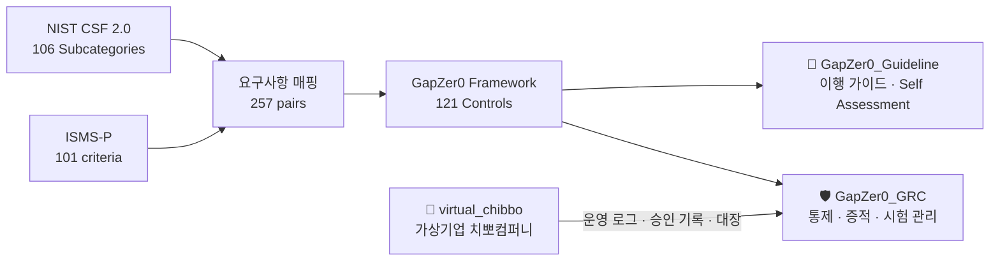

## GapZer0 Framework

| 구분 | 내용 |
| --- | --- |
| 분석 대상 | NIST CSF 2.0 Subcategory **106개** × ISMS-P 인증기준 **101개** |
| 매핑 방식 | 요구사항을 Subject · Action · Object · Security Objective로 정규화한 뒤 쌍(pair) 단위로 판정 |
| 판정 척도 | Direct(3) · Partial(2) · Related(1) · N/A(0) |
| 매핑 결과 | 총 **257개** 매핑 쌍, 이 중 Direct는 26건(10.1%) |
| 미대응 요구사항 | Framework Gap **30개**, ISMS-P 고유 요구사항 **15개** |
| 통제체계 | **15개** Security Domain, **121개** Control (Framework v0.1) |
| 평가 문항 | Assessment Question **489개**: Design 132 · Implementation 208 · Operating Effectiveness 149 |

### 매핑 판정 기준

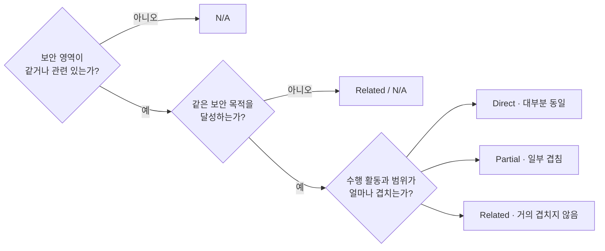

키워드가 비슷하다는 이유만으로 판정하지 않고, 억지로 1:1 매핑하지 않습니다. 여러 Partial·Related가 모여도 Direct로 올리지 않으며, 모든 판정에는 근거(Mapping Rationale)를 남겼습니다.

### Control Class

| Class | 개수 | 의미 |
| --- | :---: | --- |
| **Common** | 76 | 두 체계의 보안 목적과 수행 활동이 겹치는 요구사항을 하나로 통합한 통제 |
| **Enhancement** | 30 | CSF 2.0 Outcome 달성을 위해 대응 ISMS-P 요구사항에 더해 추가로 이행할 내용을 정의한 통제 |
| **Local** | 15 | CSF 2.0에 대응 항목이 없는 ISMS-P 고유 요구사항 (개인정보 처리 단계의 적법성 등) |

Control ID는 `GOV-C-01`(Governance · Common · 01)처럼 도메인·Class·번호로 구성합니다. Assessment Question ID는 `GOV-C-01-AQ-D-01`처럼 통제 ID 뒤에 평가 관점(D/I/O)과 번호를 붙입니다.

<b>15개 Security Domain별 통제 수</b>

| Prefix | Security Domain | 합계 | Common | Enhancement | Local |
| --- | --- | :---: | :---: | :---: | :---: |
| GOV | Governance | 17 | 11 | 6 | – |
| AST | Asset Management | 9 | 7 | 2 | – |
| CON | Continuity | 11 | 8 | 3 | – |
| HRS | Human Resource Security | 3 | 3 | – | – |
| IAM | Identity and Access Management | 6 | 3 | 2 | 1 |
| INF | Information Protection | 6 | 1 | 2 | 3 |
| ISA | Information Security Assurance | 5 | 5 | – | – |
| IEM | Information Security Event Management | 22 | 18 | 4 | – |
| LCM | Legal and Compliance | 10 | – | 1 | 9 |
| PHY | Physical Security | 4 | 3 | – | 1 |
| APP | Application Security | 1 | – | 1 | – |
| SCF | Secure Configuration | 2 | 2 | – | – |
| SUP | Supplier Relationships Security | 14 | 8 | 5 | 1 |
| SNS | System and Network Security | 1 | 1 | – | – |
| TVM | Threat and Vulnerability Management | 10 | 6 | 4 | – |
| | **합계** | **121** | **76** | **30** | **15** |

## Repositories

### 📘 [GapZer0_Guideline](https://github.com/whs4-GapZer0/GapZer0_Guideline)

> GapZer0 Framework의 실무 이행 매뉴얼 · 🌐 [docs.whs4-gapzer0.kro.kr](https://docs.whs4-gapzer0.kro.kr/)

각 Control을 **누가, 언제, 어떻게 이행하고 무엇으로 결과를 확인할지** 설명하는 웹 가이드라인입니다.

- 15개 Security Domain별로 Control Objective · Statement · 적용 조건 · Owner · Stakeholders · Implementation Guide · Evidence를 제공합니다.
- **Self Assessment**에서는 Assessment Question을 기준으로 이행 상태와 근거를 기록합니다. 평가는 충족 / 부분 충족 / 미충족 / 적용 제외 / 확인 필요의 5단계이며, 작성 내용은 정해진 Excel 템플릿으로 내보내고 다시 불러올 수 있습니다.
- 내용은 Domain·Class별 Markdown 파일로 나뉘어 있습니다. Framework가 바뀌면 해당 파일만 고치고, 변경 이력은 Git으로 추적합니다.

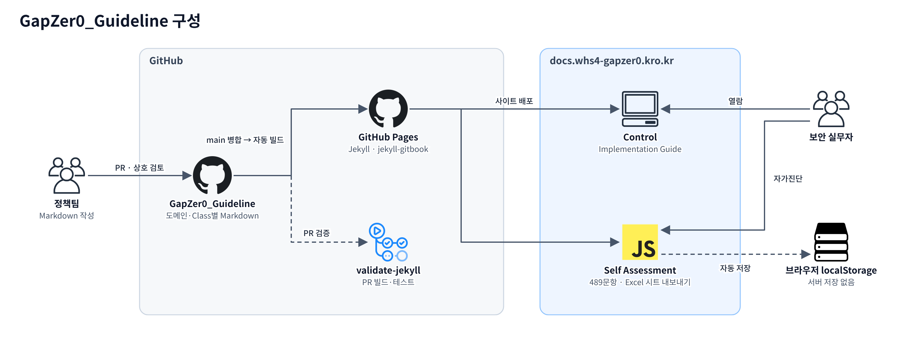

<table>
  <tr>
    <td width="50%">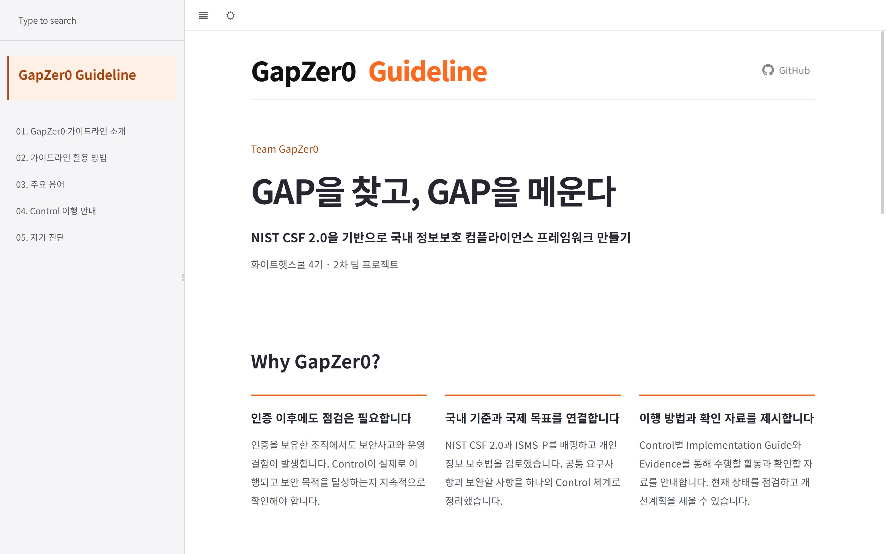</td>
    <td width="50%">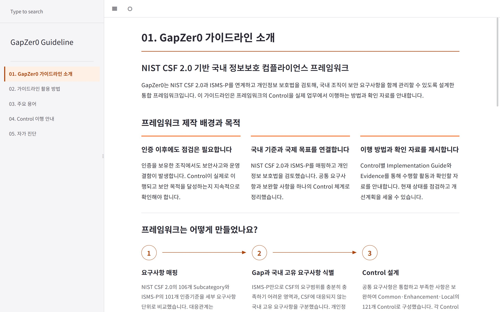</td>
  </tr>
  <tr>
    <td align="center"><b>가이드라인 표지</b> GAP을 찾고, GAP을 메운다</td>
    <td align="center"><b>01. 가이드라인 소개</b> 프레임워크 제작 배경과 목적</td>
  </tr>
  <tr>
    <td width="50%">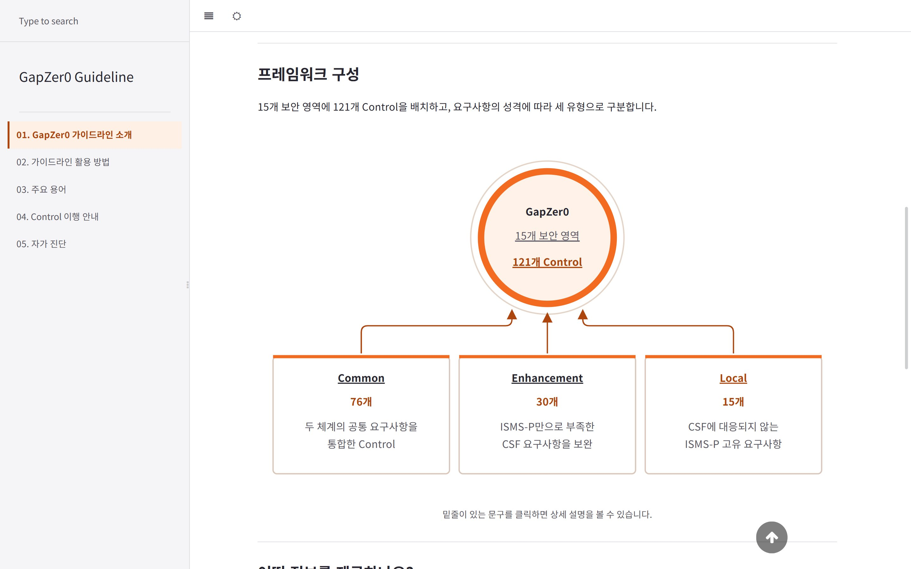</td>
    <td width="50%">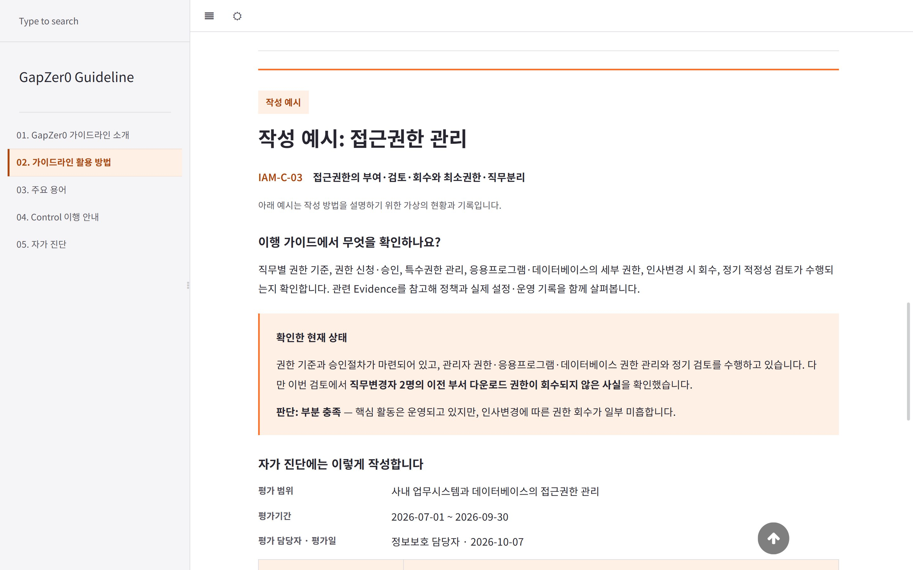</td>
  </tr>
  <tr>
    <td align="center"><b>01. 가이드라인 소개</b> 15개 보안 영역 · 121개 Control 구성</td>
    <td align="center"><b>02. 가이드라인 활용 방법</b> 작성 예시로 보는 이행 확인과 자가진단</td>
  </tr>
  <tr>
    <td width="50%">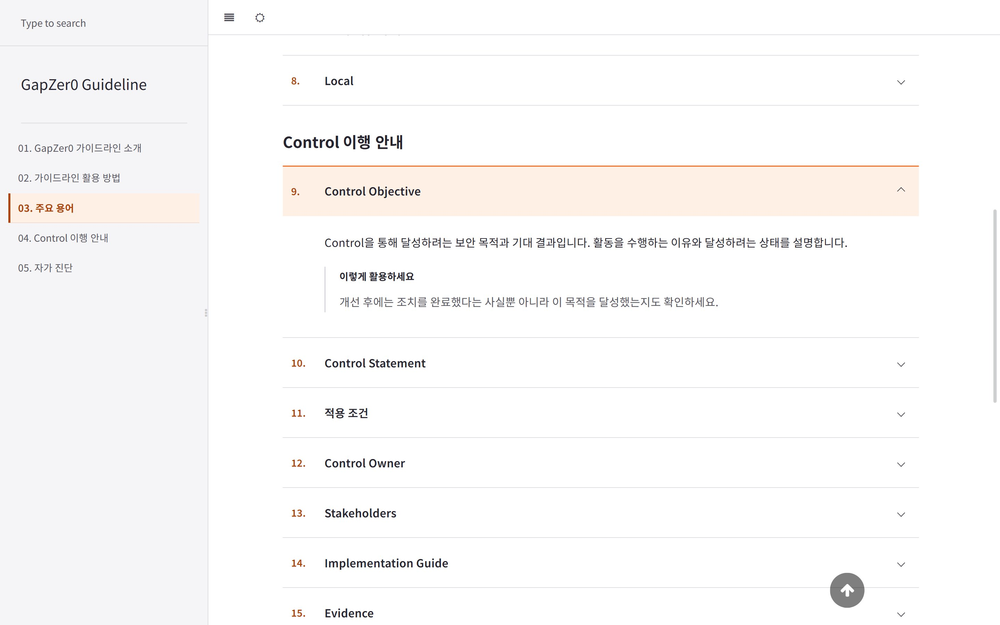</td>
    <td width="50%">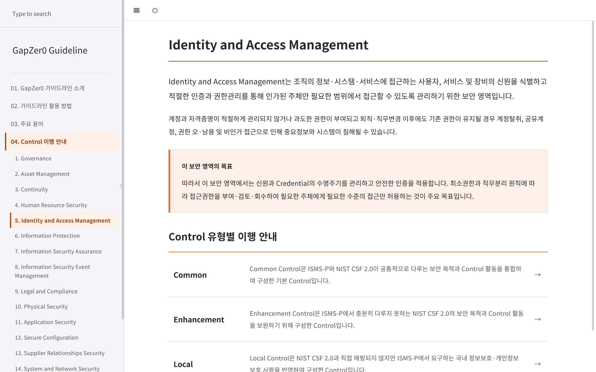</td>
  </tr>
  <tr>
    <td align="center"><b>03. 주요 용어</b> Control 이행 안내 항목 설명</td>
    <td align="center"><b>04. Control 이행 안내</b> 보안 영역별 목표와 Control 유형 안내</td>
  </tr>
  <tr>
    <td width="50%">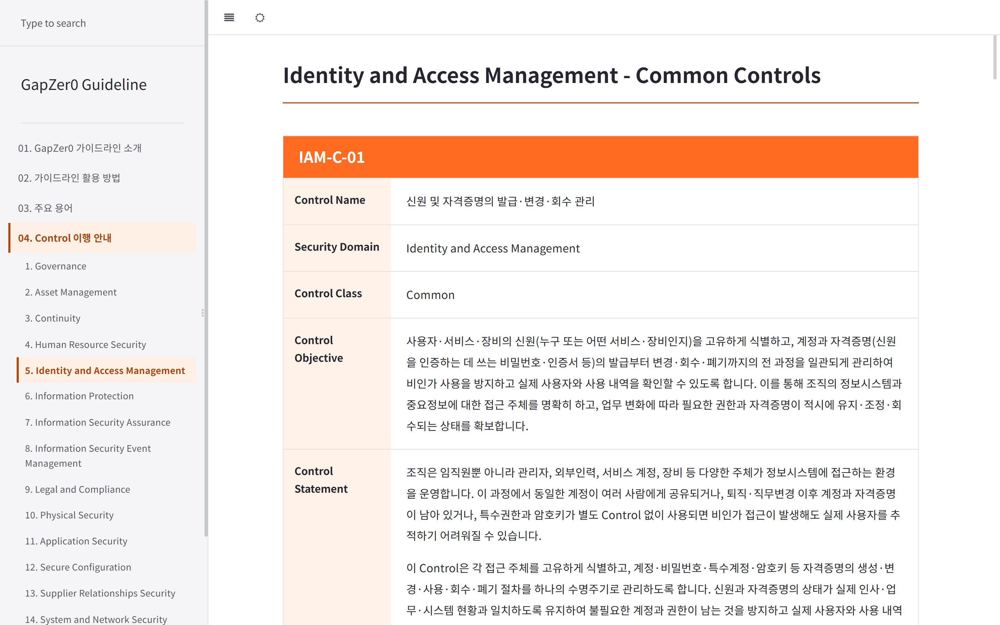</td>
    <td width="50%">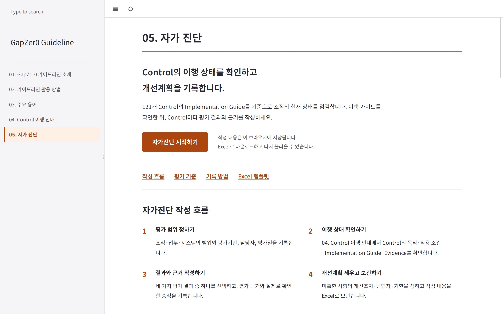</td>
  </tr>
  <tr>
    <td align="center"><b>Control 상세</b> IAM-C-01 Common Control 설명</td>
    <td align="center"><b>05. 자가 진단</b> 작성 흐름 · 평가 기준 · Excel 템플릿 안내</td>
  </tr>
  <tr>
    <td width="50%">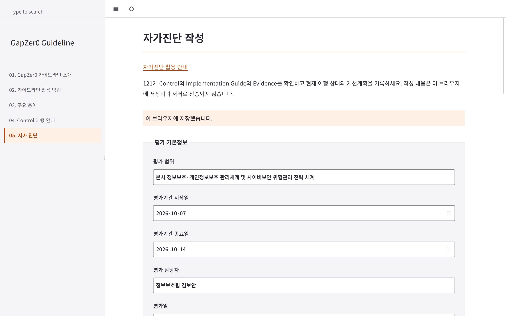</td>
    <td width="50%">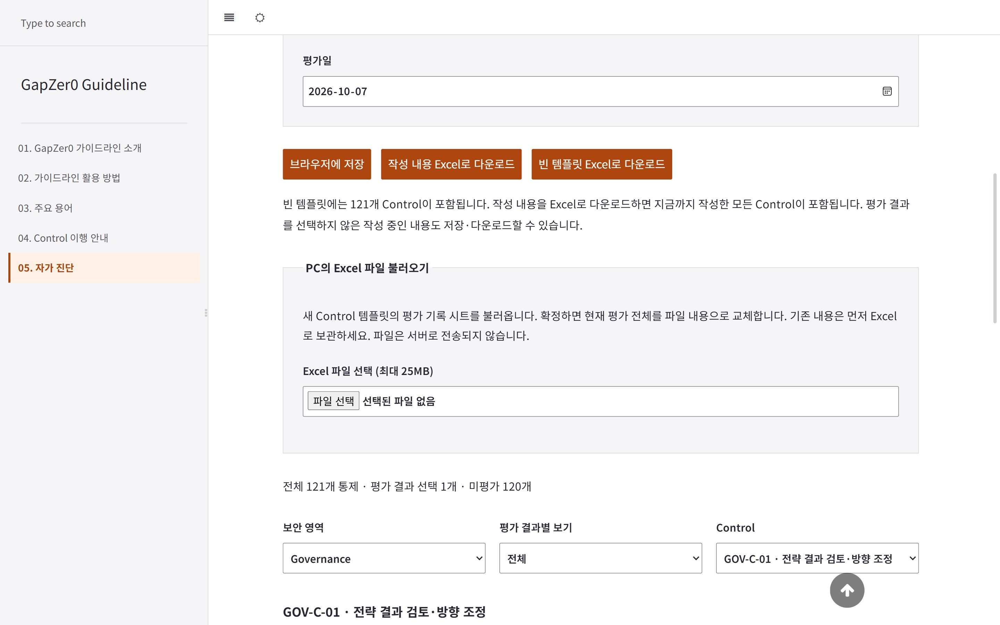</td>
  </tr>
  <tr>
    <td align="center"><b>자가진단 작성 (1)</b> 평가 기본정보 입력</td>
    <td align="center"><b>자가진단 작성 (2)</b> Excel 다운로드 · 불러오기와 Control 선택</td>
  </tr>
  <tr>
    <td width="50%">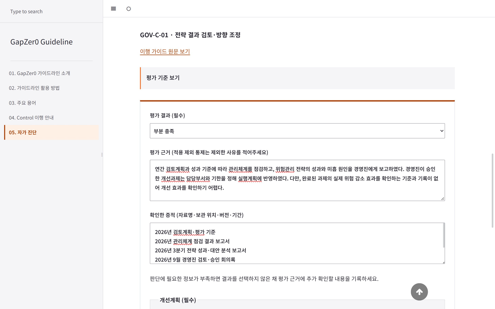</td>
    <td width="50%">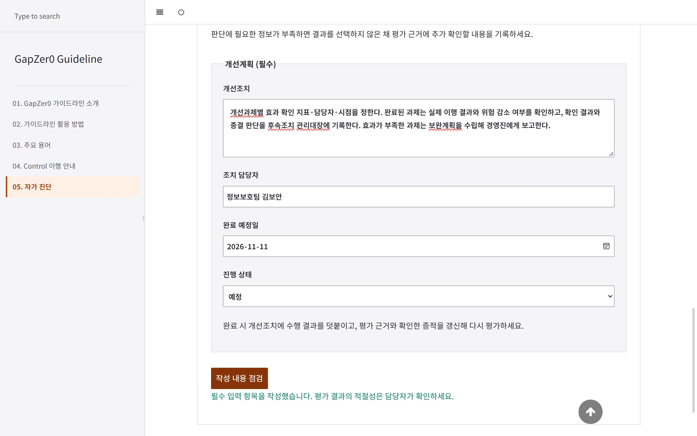</td>
  </tr>
  <tr>
    <td align="center"><b>자가진단 작성 (3)</b> 평가 결과 · 근거 · 확인한 증적 기록</td>
    <td align="center"><b>자가진단 작성 (4)</b> 개선계획 작성과 작성 내용 점검</td>
  </tr>
</table>

### 🛡️ GapZer0_GRC 🔒 Private

> GapZer0 Framework 기반 GRC 운영 대시보드와 업무 API · 🌐 [whs4-gapzer0.kro.kr](https://whs4-gapzer0.kro.kr/) (로그인 필요)

Framework를 실제 조직 운영에 적용해 통제 준수 현황을 관리하는 GRC 도구입니다.

- **Framework 카탈로그**: 발행본(release) 단위로 121개 통제와 ISMS-P / CSF 매핑을 조회합니다.
- **인스턴스별 통제 관리**: 법인 · 서비스 · 시스템 단위로 적용 통제, 시험 통과율, Domain별 현황을 한 화면에서 집계합니다.
- **증적 수명주기**: 증적 버전 관리 · 검토 · 만료 확인, 재시험(수동 / 자동 / 하이브리드), 개선과제 · 예외 관리를 지원합니다.
- **보안 도구 연동 자동 검증**: Prowler, Wazuh, Greenbone, NetBox, Google Drive 대장 등에서 원본 증적을 수집해 통제별로 판정합니다. 자동 판정은 담당자가 확정하기 전까지 제안 결과로만 다룹니다.
- **업무 감사 기록 · 알림 · AI 운영 브리핑**: DB에 기록된 근거만 사용하는 보조 기능입니다.

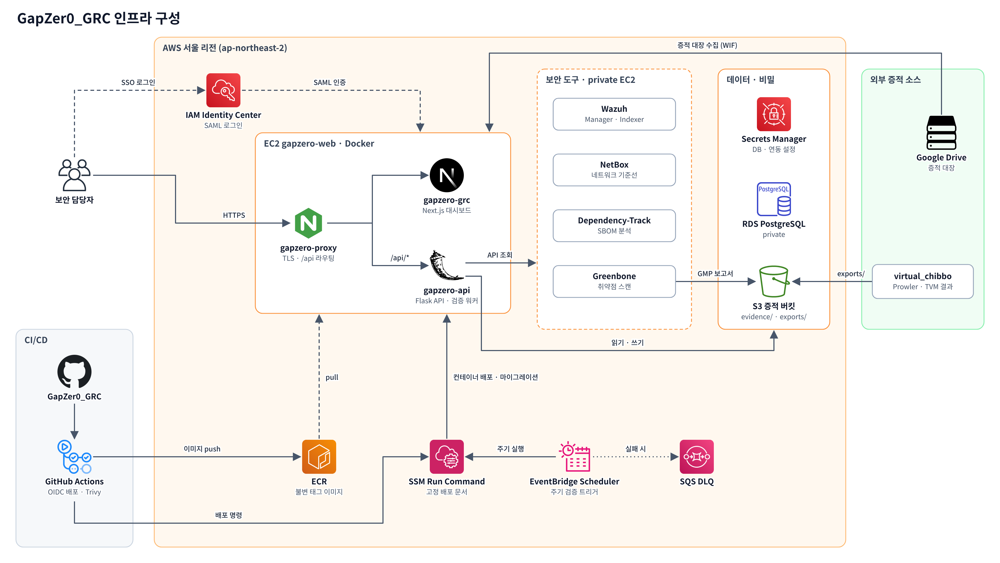

대시보드는 IAM Identity Center 계정으로 로그인해야 열 수 있어, 주요 화면을 캡처해 두었습니다. 화면의 데이터는 가상기업 치뽀컴퍼니의 합성 데이터입니다.

<table>
  <tr>
    <td width="50%">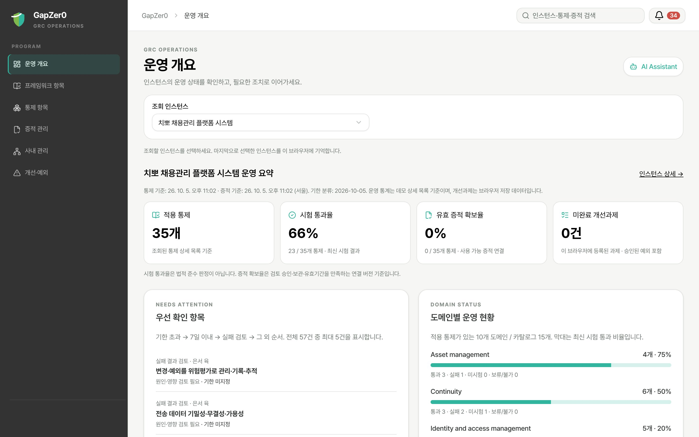</td>
    <td width="50%">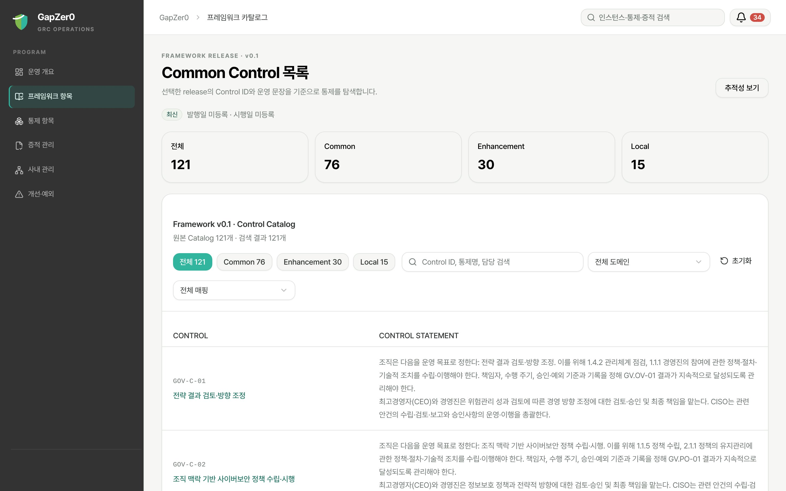</td>
  </tr>
  <tr>
    <td align="center"><b>운영 개요</b> 인스턴스별 적용 통제 · 시험 통과율 · 우선 확인 항목</td>
    <td align="center"><b>프레임워크 카탈로그</b> Framework v0.1의 121개 통제 탐색</td>
  </tr>
  <tr>
    <td width="50%">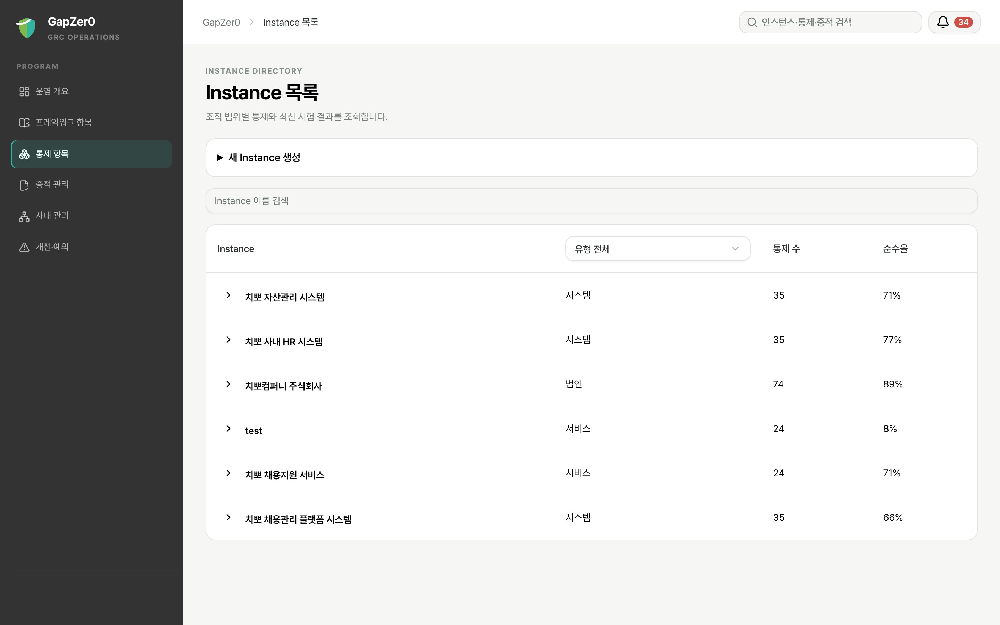</td>
    <td width="50%">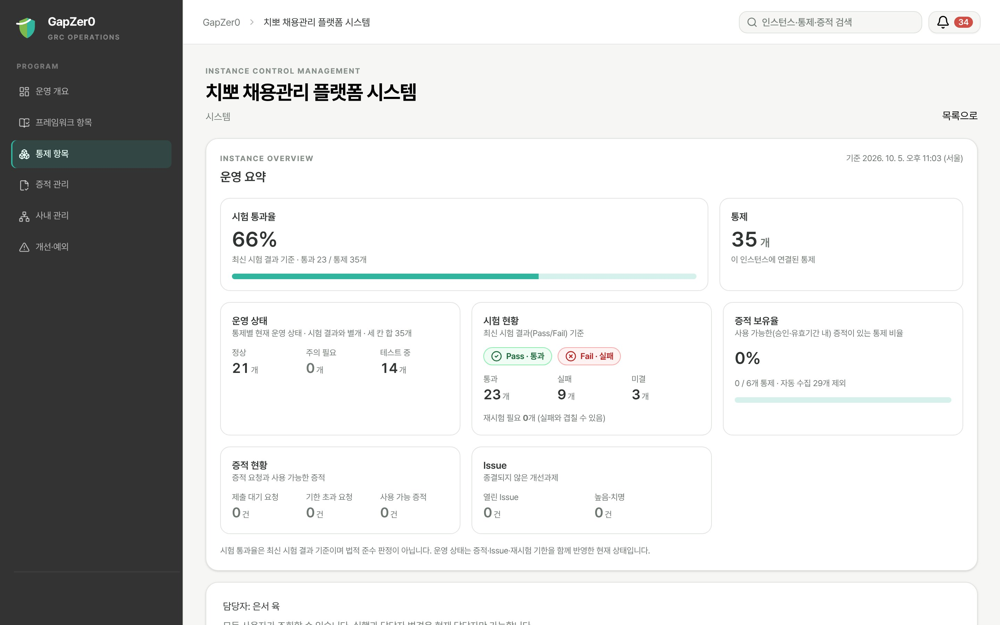</td>
  </tr>
  <tr>
    <td align="center"><b>Instance 목록</b> 법인 · 서비스 · 시스템별 통제 수와 준수율</td>
    <td align="center"><b>인스턴스 통제 관리</b> 운영 상태 · 시험 현황 · 증적 보유율</td>
  </tr>
  <tr>
    <td width="50%">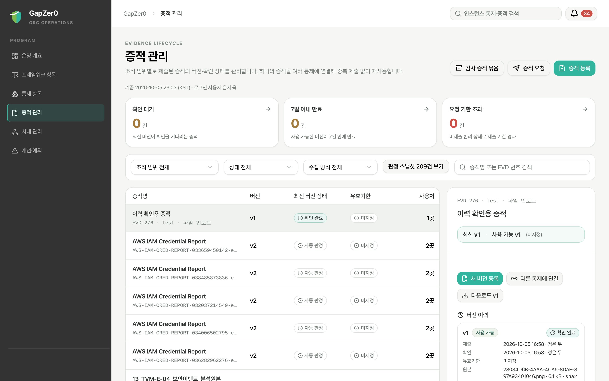</td>
    <td width="50%">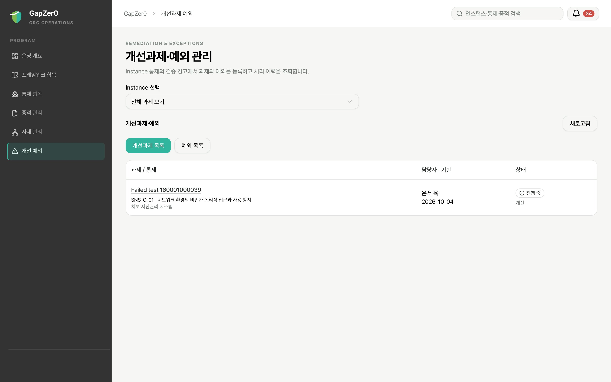</td>
  </tr>
  <tr>
    <td align="center"><b>증적 관리</b> 증적 버전 · 확인 상태 · 재사용 통제</td>
    <td align="center"><b>개선과제 · 예외 관리</b> 검증 실패에서 이어지는 과제와 예외 처리</td>
  </tr>
  <tr>
    <td width="50%">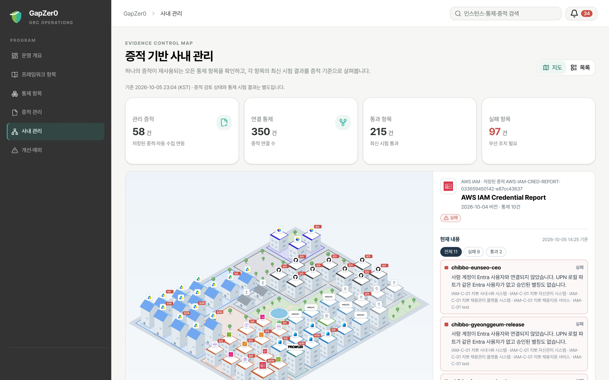</td>
    <td width="50%">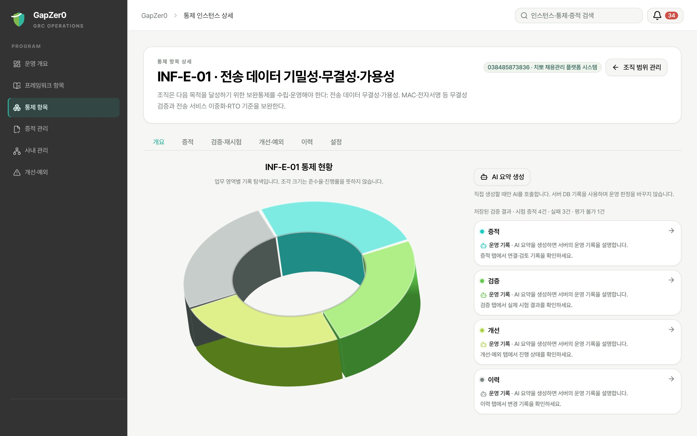</td>
  </tr>
  <tr>
    <td align="center"><b>증적 기반 사내 관리</b> 증적과 연결 통제 · 최신 시험 결과를 지도로 탐색</td>
    <td align="center"><b>통제 상세 · INF-E-01</b> 증적 · 검증 · 개선 · 이력 기록 탐색</td>
  </tr>
  <tr>
    <td width="50%">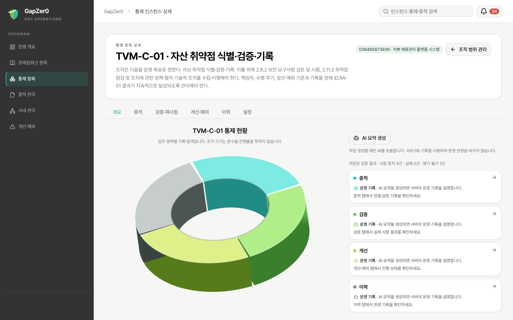</td>
    <td width="50%">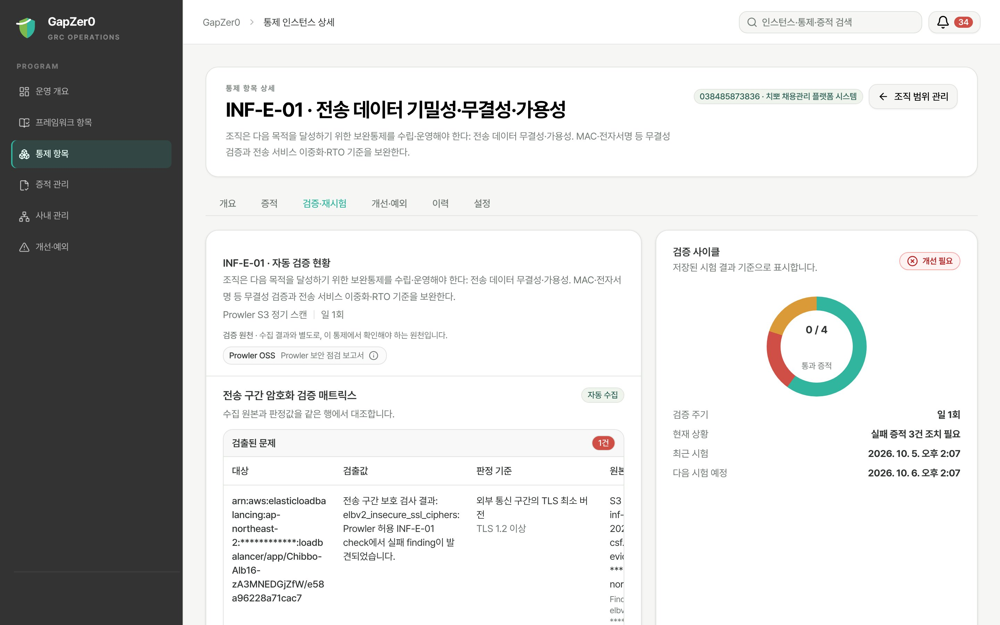</td>
  </tr>
  <tr>
    <td align="center"><b>통제 상세 · TVM-C-01</b> 통제별 운영 기록과 AI 요약</td>
    <td align="center"><b>자동 검증 · INF-E-01</b> Prowler 결과로 전송 구간 암호화 판정</td>
  </tr>
  <tr>
    <td width="50%">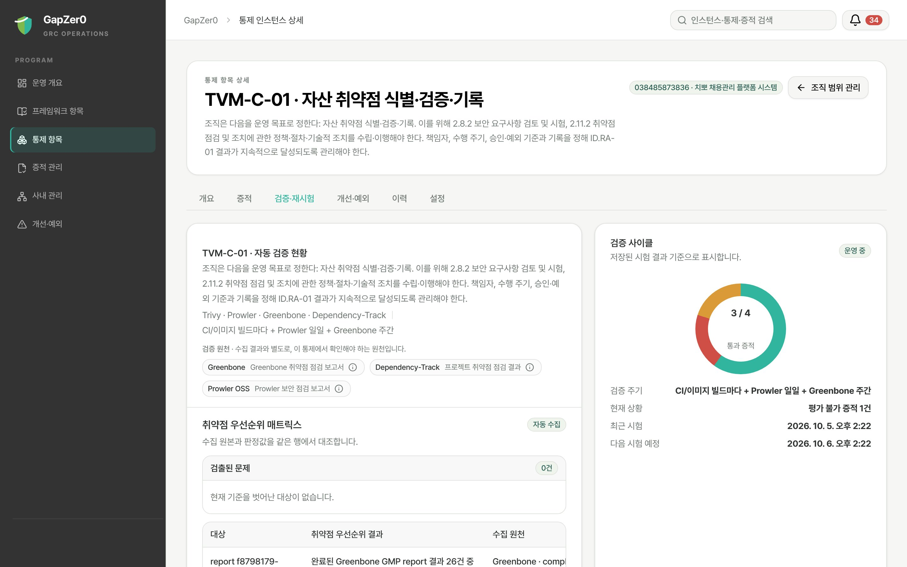</td>
    <td width="50%">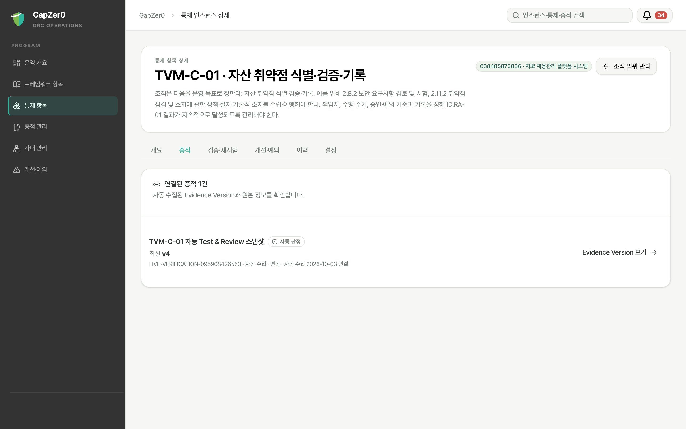</td>
  </tr>
  <tr>
    <td align="center"><b>자동 검증 · TVM-C-01</b> Trivy · Prowler · Greenbone · Dependency-Track 취약점 판정</td>
    <td align="center"><b>연결 증적 · TVM-C-01</b> 자동 수집 Test & Review 스냅샷</td>
  </tr>
</table>

### 🏢 [virtual_chibbo](https://github.com/whs4-GapZer0/virtual_chibbo)

> 치뽀컴퍼니 채용 지원서 접수 SaaS · 가상기업 서비스 · 🌐 [app.chibbo-job.kro.kr](https://app.chibbo-job.kro.kr/jobs)

GRC 도구가 **실제 운영 흔적**을 대상으로 제대로 판정하는지 검증하려고 만든 가상기업입니다. 모든 인물 · 고객사 · 데이터는 가상이며, 실제 지원자 개인정보는 다루지 않습니다.

- **서비스**: 지원자 공고 지원, 고객사 담당자 심사, 관리자 고객사 관리로 구성된 멀티테넌트 채용지원 SaaS입니다.
- **보안 설계**: 서버가 검증한 `company_id`와 PostgreSQL RLS로 테넌트를 격리하고, 이력서는 private S3에 저장하며, 로그인은 Entra OIDC를 씁니다.
- **운영 환경**: IAM Identity Center 기반 최소 권한 AWS 환경에 CloudTrail · VPC Flow Logs · 앱 감사 로그를 갖췄습니다.
- **GRC 인스턴스**: 법인 1개(치뽀컴퍼니 주식회사), 서비스 1개(채용지원 서비스), 시스템 3개(채용관리 플랫폼 · 사내 HR · 자산관리)로 등록했습니다.
- **증적**: 정책서, 통제운영대장, 개인정보 처리현황, 인원·권한 / 자산·공급자 / 변경·취약점 대장, 사고대응 절차서, 점검·훈련·복구시험 보고서, PR 승인과 변경·위험 수용 이슈를 GRC 증적으로 연결했습니다.
- **검증 방식**: 증적 곳곳에 결함 7개를 일부러 심어 두고, GRC가 그 결함을 찾아내는지로 판정 흐름을 확인합니다.

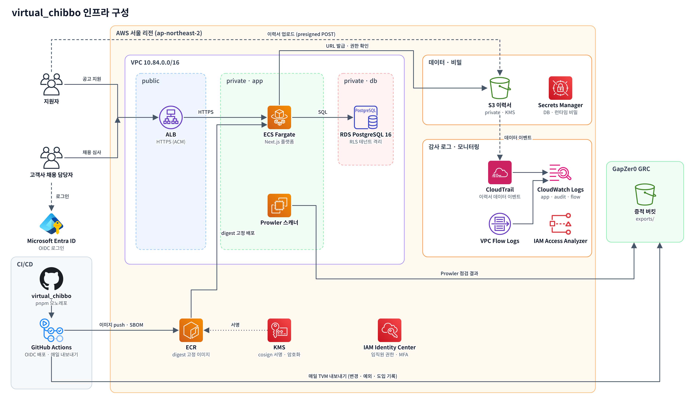

## 🛠️ 기술 스택

### Front-end
       

### Back-end
      

### Infra & DevOps
         

### Security & Integration
       

### Guideline
   

## Timeline

| 기간 (2026) | 단계 | 주요 내용 |
| --- | --- | --- |
| 08.06 – 08.13 | 문헌 조사 | NIST CSF 2.0 · ISMS-P · 개인정보보호법 · RMF(SP 800-37) 학습 |
| 08.14 – 08.27 | 요구사항 매핑 | A팀(GV·ID) · B팀(PR·DE·RS·RC) 분담 매핑, 팀 간 교차 Peer Review, Lead Review |
| 09.05 | 중간 발표 | 매핑 결과와 주요 Gap 발표 |
| 09.06 – 09.23 | 프레임워크 설계 | 멘토 피드백을 반영해 최종 매핑·Gap 확정, 121개 통제 Framework v0.1 설계 |
| 09.17 – 10.07 | 가이드라인 · GRC 제작 | 정책팀은 웹 가이드라인, 기술팀은 GRC 도구 · AWS 인프라 · 가상기업 제작 |
| 10.17 | 최종 발표 | 프로젝트 최종 발표 |

## Team

<table>
  <tbody>
    <tr>
      <td align="center"><a href="https://github.com/Hkksi"> <b>@Hkksi</b></a></td>
      <td align="center"><a href="https://github.com/Gee1-234"> <b>@Gee1-234</b></a></td>
      <td align="center"><a href="https://github.com/6kitty"> <b>@6kitty</b></a></td>
      <td align="center"><a href="https://github.com/nadoara00"> <b>@nadoara00</b></a></td>
      <td align="center"><a href="https://github.com/jimonkey00"> <b>@jimonkey00</b></a></td>
    </tr>
    <tr>
      <td align="center">PM · GRC <b>홍석현</b></td>
      <td align="center">TL · Guideline <b>박지원</b></td>
      <td align="center">TL · GRC <b>육은서</b></td>
      <td align="center">GRC <b>두경은</b></td>
      <td align="center">Guideline <b>우지민</b></td>
    </tr>
    <tr>
      <td align="center"><a href="https://github.com/young33171"> <b>@young33171</b></a></td>
      <td align="center"><a href="https://github.com/jae-yoonlee"> <b>@jae-yoonlee</b></a></td>
      <td align="center"><a href="https://github.com/isayzero"> <b>@isayzero</b></a></td>
      <td align="center"><a href="https://github.com/zer0-kr"> <b>@zer0-kr</b></a></td>
      <td align="center"><a href="https://github.com/kkimklara"> <b>@kkimklara</b></a></td>
    </tr>
    <tr>
      <td align="center">Guideline <b>이영언</b></td>
      <td align="center">GRC <b>이재윤</b></td>
      <td align="center">GRC <b>정세영</b></td>
      <td align="center">Mentor <b>공지훈</b></td>
      <td align="center">PL <b>김채영</b></td>
    </tr>
  </tbody>
</table>

 

---

**GAP을 찾고, GAP을 메운다** · Team GapZer0

